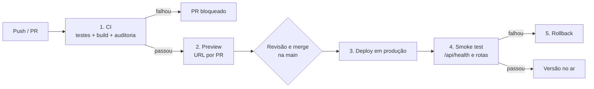

# Entrega e Implantação Contínua (CD) no Whiskerworld

Proposta de como aplicar **Entrega Contínua** e **Implantação Contínua** ao Whiskerworld: por que vale a pena, o que o projeto já tem, o que falta e as etapas para implantar. A referência é o [capítulo 10 de *Engenharia de Software Moderna*](https://engsoftmoderna.info/cap10.html) (DevOps).

> **Resumo:** o Whiskerworld já tem os pré-requisitos (versionamento com PRs, 67 testes automatizados e configuração de hospedagem na Vercel), mas nada roda esses testes automaticamente nem verifica o sistema depois de publicado. Ao analisar o projeto para esta proposta, encontramos problemas de publicação que os testes atuais não detectam e que um pipeline de CD apontaria logo no primeiro deploy.

---

## 1. Conceitos

| Prática | O que significa | Quem decide publicar |
|---|---|---|
| **Integração Contínua (CI)** | A cada push ou PR, o código é testado e compilado automaticamente. Integrações pequenas e frequentes, em vez de uma grande no final. | — |
| **Entrega Contínua** (*Continuous Delivery*) | Todo código que passa no pipeline fica **pronto para produção**. Publicar é uma decisão de negócio, tomada com um clique. | Uma pessoa |
| **Implantação Contínua** (*Continuous Deployment*) | Igual à Entrega Contínua, mas sem o clique: passou no pipeline, vai **direto para produção**. | O pipeline |

A Integração Contínua é a base das outras duas. A diferença entre Entrega e Implantação Contínua está só na última etapa: **manual ou automática**.

---

## 2. Situação atual do projeto

| Item | Situação | Onde |
|---|---|---|
| Controle de versão com Pull Requests | ✅ Já existe | Fluxo de branches e PRs usado desde a TP1 |
| Testes automatizados do backend | ✅ 60 testes, todos passando | `backend/tests/` (`npm test`) |
| Testes automatizados do frontend | ✅ 7 testes, todos passando | `client/tests/` e `client/src/*.test.jsx` (`npm test` em `client/`) |
| Build automatizável do frontend | ✅ Já existe | `vite build` (`npm run build:frontend`) |
| Configuração de hospedagem | ✅ Já existe | `vercel.json` e `api/index.js` (Vercel) |
| Pipeline que roda os testes sozinho | ❌ Não existe | Não há `.github/workflows/` |
| Bloqueio de merge quando um teste falha | ❌ Não existe | Depende de alguém lembrar de rodar `npm test` |
| Verificação do sistema depois de publicado | ❌ Não existe | — |
| Ambiente de testes separado da produção | ❌ Não existe | Há um único projeto Firebase |

**Conclusão:** já temos os testes e a hospedagem, mas falta automatizar o caminho entre o PR e a produção.

---

## 3. Por que vale a pena para este projeto

1. **Os testes da TP5 passam a ser uma regra, não um hábito.** A TP5 criou dezenas de testes de caracterização para garantir que as refatorações não mudassem o comportamento. Hoje, eles só protegem o sistema se alguém lembrar de rodá-los. Com CI, nenhum PR entra na `main` com teste falhando.

2. **Quatro pessoas mexendo nos mesmos arquivos.** Na TP5, duas refatorações alteraram a mesma condição (`acompanhamentosService.js`) e geraram conflito. Integrar com frequência e testar cada integração automaticamente reduz o tamanho e o risco desses conflitos.

3. **Os testes atuais não verificam a publicação.** Eles testam os serviços isoladamente, com dublês do Firebase. Erros de configuração de deploy passam despercebidos, como os da seção 4.

4. **Revisar vendo o sistema funcionando.** Com um ambiente de *preview* por PR, quem revisa abre uma URL e usa a funcionalidade, em vez de só ler o código. Isso é especialmente útil para as mudanças de interface e acessibilidade das TPs anteriores.

5. **Erros em produção ficam baratos de desfazer.** Com deploys pequenos e frequentes, quando algo quebra é fácil saber qual mudança causou o problema e voltar à versão anterior.

---

## 4. Problemas encontrados que um pipeline teria detectado

Ao analisar o projeto para esta proposta, encontramos divergências entre o ambiente de desenvolvimento e o de produção. Nenhuma delas aparece nos testes atuais. Elas foram identificadas pela leitura da configuração e ainda precisam ser confirmadas no ambiente publicado.

| # | Problema | Evidência | Consequência provável | Etapa do pipeline que detectaria |
|---|---|---|---|---|
| P1 | **Rotas novas sem regra na Vercel** | `vercel.json` encaminha à API só `/animais`, `/usuarios`, `/agendamentos`, `/favoritos` e `/uploads`. O `backend/server.js` também registra `/compatibilidade`, `/adocoes`, `/acompanhamentos`, `/docs` e `/api/health`. | Em produção, essas requisições caem na regra `/(.*)` e vão para o frontend: questionário de compatibilidade, adoções e acompanhamento pós-adoção não funcionariam. | Smoke test (etapa 4) |
| P2 | **Pasta do build divergente** | `client/vite.config.js` gera o build em `dist`. O `vercel.json` procura em `frontend-react`. | O build do frontend na Vercel não encontraria os arquivos gerados. | Deploy de preview (etapa 2) |
| P3 | **Dev e produção configurados em lugares diferentes** | As rotas novas foram adicionadas ao *proxy* do Vite (`vite.config.js`), que só vale em desenvolvimento, mas não ao `vercel.json`. | O sistema funciona na máquina de quem desenvolve e falha publicado. É a causa de P1. | Preview e smoke test (etapas 2 e 4) |
| P4 | **Dependências com vulnerabilidades** | O GitHub (Dependabot) aponta 32 vulnerabilidades nas dependências da `main` (3 críticas, 11 altas). | Risco de segurança que ninguém acompanha. | Auditoria de dependências (etapa 1) |
| P5 | **Configuração do Firebase fixa no código** | `client/src/firebase.js` e `backend/src/routes/apiDashboard.js` têm a configuração do projeto Firebase escrita no código. | A chave web do Firebase é pública por natureza, então isso não é um vazamento. O problema é que não dá para apontar o preview para um Firebase de testes sem editar o código. | Configuração por ambiente (etapa 2) |

> P1 e P3 mostram bem o valor de CD: cada pessoa testou a sua funcionalidade localmente, e ela funcionou. O erro só aparece quando o sistema é publicado, e hoje ninguém verifica o sistema publicado.

---

## 5. Pipeline proposto



Ferramentas: **GitHub Actions** (com cota gratuita de uso) para o CI, e a **integração da Vercel com o GitHub** para preview, deploy e rollback. As duas já combinam com o que o projeto usa.

---

## 6. Etapas de implantação

### Etapa 0 — Corrigir a configuração atual

Antes de automatizar o deploy, corrigir P1 e P2 no `vercel.json`: incluir as rotas que faltam e usar a mesma pasta de build do Vite. Automatizar um deploy quebrado só faria ele quebrar mais rápido.

### Etapa 1 — Integração Contínua com GitHub Actions

Criar `.github/workflows/ci.yml`, executado em todo PR e em todo push na `main`:

```yaml
name: CI

on:
  pull_request:
  push:
    branches: [main]

jobs:
  testes:
    runs-on: ubuntu-latest
    steps:
      - uses: actions/checkout@v4
      - uses: actions/setup-node@v4
        with:
          node-version: 22
          cache: npm

      - name: Instala dependências
        run: npm ci && npm ci --prefix client

      - name: Testes do backend
        run: npm test

      - name: Testes do frontend
        run: npm test --prefix client

      - name: Build do frontend
        run: npm run build --prefix client

      - name: Auditoria de dependências
        run: npm audit --audit-level=critical
```

Depois, ativar a **proteção da branch `main`** no GitHub (*Settings → Branches → Branch protection rules*), exigindo que o job `testes` passe antes do merge. É isso que transforma os testes em regra.

### Etapa 2 — Ambiente de preview por PR

- Conectar o repositório à Vercel. A partir daí, cada PR ganha uma **URL própria**, comentada automaticamente no PR.
- Criar um **segundo projeto Firebase, só para testes**, e configurar o preview para usá-lo. Assim, testar no preview nunca altera dados reais de usuários e animais.
- Mover a configuração do Firebase do código para **variáveis de ambiente** (`VITE_FIREBASE_*` no frontend e `FIREBASE_SERVICE_ACCOUNT` no backend), com um valor para preview e outro para produção (resolve P5).

### Etapa 3 — Deploy em produção

Aqui se escolhe entre as duas práticas (ver seção 7):

- **Entrega Contínua:** o merge na `main` gera uma versão pronta, mas a publicação espera aprovação. No GitHub, isso se faz com um *environment* `production` com revisores obrigatórios.
- **Implantação Contínua:** o merge na `main` publica sozinho. É o comportamento padrão da integração da Vercel.

Em ambos os casos, as credenciais ficam só nas configurações da Vercel e do GitHub (*Secrets*), nunca no repositório.

### Etapa 4 — Smoke test depois do deploy

Logo após cada publicação, uma verificação automática acessa o sistema no ar:

- `GET /api/health` deve responder `200`;
- uma rota de cada grupo (`/animais`, `/compatibilidade/...`, `/adocoes/...`) deve chegar à API, e não ao frontend.

É a verificação mais simples do pipeline, e é a que detectaria P1 no primeiro deploy.

### Etapa 5 — Rollback

Se o smoke test falhar, voltar à versão anterior:

- pela Vercel, com **Instant Rollback** (um clique, sem novo build); ou
- pelo Git, com `git revert` do merge que causou o problema, o que dispara um novo deploy já corrigido.

---

## 7. Entrega ou Implantação Contínua?

**Recomendação: começar com Entrega Contínua e evoluir para Implantação Contínua.**

| | Entrega Contínua | Implantação Contínua |
|---|---|---|
| Publicação | Com aprovação de uma pessoa | Automática |
| Exige | Testes confiáveis | Testes confiáveis **e** abrangentes, monitoramento |
| Situação do Whiskerworld | ✅ Viável agora | ⚠️ Ainda não |

Por que começar pela Entrega Contínua:

- **Os testes do frontend ainda são poucos** (7, de acessibilidade e rotas). As páginas não têm testes de comportamento, então uma mudança de interface pode passar no pipeline e mesmo assim quebrar uma tela.
- **A produção usa dados reais no Firebase**, e um erro em produção afeta adotantes e abrigos.
- **O grupo ainda está ajustando o fluxo de integração**, como mostraram os conflitos da TP5.

Quando houver testes de interface e smoke tests estáveis, o passo de aprovação pode ser removido, o que transforma a Entrega Contínua em Implantação Contínua sem mudar mais nada no pipeline.

---

## 8. Cuidados e limitações

- **Testes não provam ausência de erros.** O pipeline só é tão bom quanto os testes que ele roda. CD aumenta a importância de continuar escrevendo testes, principalmente no frontend.
- **Dados de produção.** Preview e testes nunca devem usar o Firebase de produção.
- **Segredos.** A conta de serviço do Firebase (`FIREBASE_SERVICE_ACCOUNT`) dá acesso total ao banco. Ela deve existir só nas configurações da Vercel e do GitHub.
- **Custos.** GitHub Actions e Vercel têm planos gratuitos suficientes para um projeto deste tamanho, mas com limites de uso.
- **Mudanças incompletas.** Com publicação frequente, uma funcionalidade pela metade pode chegar à produção. A prática comum para isso são *feature flags* (citadas no capítulo 10): o código vai para produção desligado e é ativado quando estiver pronto.

---

## 9. Como medir se está funcionando

A literatura de DevOps usa quatro métricas, conhecidas como métricas DORA (*DevOps Research and Assessment*), para avaliar a entrega de software:

| Métrica | Pergunta | Hoje | Com CD |
|---|---|---|---|
| Frequência de deploy | Com que frequência publicamos? | Manual, sem registro | Registrada a cada merge |
| Tempo de entrega (*lead time*) | Quanto tempo do commit até a produção? | Indefinido | Minutos após o merge |
| Taxa de falha de mudanças | Quantos deploys causam problema? | Desconhecida | Medida pelo smoke test |
| Tempo de recuperação | Quanto tempo para corrigir uma falha? | Depende de alguém perceber | Rollback em um clique |

---

## 10. Resumo das etapas

| # | Etapa | O que faz | Ferramenta |
|---|---|---|---|
| 0 | Corrigir a configuração | Rotas e pasta de build no `vercel.json` | — |
| 1 | Integração Contínua | Testes, build e auditoria a cada PR; merge só se passar | GitHub Actions |
| 2 | Preview | Uma URL por PR, com Firebase de testes | Vercel |
| 3 | Deploy | Publicação da `main`, com aprovação (Entrega) ou automática (Implantação) | Vercel + GitHub Environments |
| 4 | Smoke test | Verifica o sistema no ar logo após publicar | GitHub Actions |
| 5 | Rollback | Volta à versão anterior se a verificação falhar | Vercel / `git revert` |

---

## 11. Implementação

O pipeline foi implementado seguindo as etapas acima, na modalidade **Entrega Contínua** (seção 7). Os passos que só podem ser feitos nos painéis do GitHub e da Vercel (segredos, environment com aprovação, proteção de branch) estão em [`configuracao.md`](configuracao.md).

| Etapa | Situação | Onde |
|---|---|---|
| 0 — Corrigir a configuração | ✅ P1, P2 e P3 corrigidos | [`vercel.json`](../../vercel.json) |
| 1 — Integração Contínua | ✅ Implementada | [`.github/workflows/ci.yml`](../../.github/workflows/ci.yml) |
| 2 — Preview por PR | ✅ Código pronto (P5 corrigido); ⚙️ falta criar o Firebase de testes e conectar a Vercel | [`firebase.js`](../../client/src/firebase.js), [`smoke-preview.yml`](../../.github/workflows/smoke-preview.yml) |
| 3 — Deploy com aprovação | ✅ Implementado; ⚙️ falta criar o environment `production` | [`deploy-producao.yml`](../../.github/workflows/deploy-producao.yml) |
| 4 — Smoke test | ✅ Implementado | [`scripts/smoke-test.js`](../../scripts/smoke-test.js) |
| 5 — Rollback | ✅ Automático quando o smoke test falha | [`deploy-producao.yml`](../../.github/workflows/deploy-producao.yml) |

### O que a implementação revelou

- **P4 resolvido, e uma regressão detectada pelos testes.** As vulnerabilidades críticas foram corrigidas com `npm audit fix`, sem mudanças de versão maior. A atualização levou o `multer` de 2.0.2 para 2.5.0 (a 2.0.2 tinha 9 vulnerabilidades de negação de serviço). Logo depois, o teste de caracterização do upload de fotos falhou: o multer 2.5.0 passou a aceitar uma foto de **exatamente** 2 MB, que antes era recusada. A nova regra é a mesma do serviço de acompanhamento, então o teste foi atualizado para o novo limite. É exatamente o cenário que o CI existe para pegar: sem ele, essa mudança teria passado despercebida.
- **P6 — URLs compartilhadas entre frontend e API (ainda não corrigido).** As páginas `/animais`, `/animais/:tipo` e `/adocoes/:adocaoId/acompanhamento` do React Router usam os mesmos prefixos das rotas da API. Navegando pelo app, funciona, mas abrir uma dessas URLs diretamente (recarregar a página ou colar o link) entrega o JSON da API em vez da tela. Isso acontece em produção e também no ambiente de desenvolvimento, por causa do proxy do Vite. A correção definitiva é mover a API para um prefixo próprio (por exemplo, `/api/animais`), o que envolve o backend, o frontend e os testes, e por isso ficou para um PR separado.
