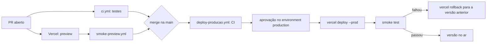

# Configuração do pipeline de CD

O pipeline proposto no [README](README.md) está implementado nos arquivos abaixo. Algumas partes, porém, só podem ser ativadas nos painéis do GitHub e da Vercel. Este guia lista esses passos, que precisam ser feitos uma única vez por quem administra o repositório.

## Arquivos do pipeline

| Etapa | Arquivo | O que faz |
|---|---|---|
| 0 | [`vercel.json`](../../vercel.json) | Todas as rotas da API, pasta de build `dist`, fallback da SPA e desativação do deploy automático da `main` pela Vercel |
| 1 | [`.github/workflows/ci.yml`](../../.github/workflows/ci.yml) | Testes do backend e do frontend, build e auditoria de dependências em todo PR |
| 2 | [`client/src/firebase.js`](../../client/src/firebase.js), [`apiDashboard.js`](../../backend/src/routes/apiDashboard.js) | Configuração do Firebase lida de variáveis de ambiente (`VITE_FIREBASE_*`, `FIREBASE_WEB_API_KEY`) |
| 2 e 4 | [`.github/workflows/smoke-preview.yml`](../../.github/workflows/smoke-preview.yml) | Smoke test na URL de preview de cada PR |
| 3, 4 e 5 | [`.github/workflows/deploy-producao.yml`](../../.github/workflows/deploy-producao.yml) | CI → aprovação → deploy → smoke test → rollback automático |
| 4 | [`scripts/smoke-test.js`](../../scripts/smoke-test.js) | Verifica o sistema publicado (`npm run smoke -- <url>`) |

## Passo 1 — Conectar a Vercel ao repositório

1. Em [vercel.com/new](https://vercel.com/new), importe `llilibet/whiskerworld`. Mantenha a raiz do projeto como diretório raiz, porque o `vercel.json` já define os builds.
2. Em **Settings → Environment Variables**, cadastre as variáveis do backend para os ambientes **Production** e **Preview**, com valores diferentes em cada um:

   | Variável | Production | Preview |
   |---|---|---|
   | `FIREBASE_SERVICE_ACCOUNT` | conta de serviço do Firebase de produção | conta de serviço do Firebase de **testes** |
   | `FIREBASE_STORAGE_BUCKET` | bucket de produção | bucket de testes |
   | `JWT_SECRET` | chave forte | outra chave |
   | `FIREBASE_WEB_API_KEY` | (opcional) | chave web do Firebase de testes |
   | `VITE_FIREBASE_*` | (opcional) | configuração web do Firebase de testes (ver [`client/.env.example`](../../client/.env.example)) |

   Sem as variáveis opcionais, o app usa o projeto de produção (`whiskerworld-ea08d`). **No Preview, elas devem ser preenchidas**, senão o preview grava dados reais.

3. Em **Settings → Tokens** da conta Vercel, crie um token para o GitHub Actions.
4. No terminal, rode `npx vercel link` na raiz do projeto. O arquivo `.vercel/project.json` criado tem o `orgId` e o `projectId`. A pasta `.vercel/` está no `.gitignore` e não deve ser versionada.

> O `vercel.json` desativa o deploy automático da `main` pela integração da Vercel (`git.deploymentEnabled.main: false`). Os previews dos PRs continuam automáticos, mas a produção só é publicada pelo GitHub Actions, depois da aprovação.

## Passo 2 — Segredos no GitHub

Em **Settings → Secrets and variables → Actions** do repositório:

| Tipo | Nome | Valor |
|---|---|---|
| Secret | `VERCEL_TOKEN` | token criado no passo 1.3 |
| Secret | `VERCEL_ORG_ID` | `orgId` de `.vercel/project.json` |
| Secret | `VERCEL_PROJECT_ID` | `projectId` de `.vercel/project.json` |
| Secret | `VERCEL_AUTOMATION_BYPASS_SECRET` | só se o projeto tiver *Deployment Protection*: **Settings → Deployment Protection → Protection Bypass for Automation** na Vercel |
| Variable | `PRODUCTION_URL` | domínio público, por exemplo `https://whiskerworld.vercel.app` |

Cadastre os segredos no nível do **repositório**, não do environment: o job de rollback roda fora do environment `production`.

## Passo 3 — Aprovação manual (Entrega Contínua)

Em **Settings → Environments**, crie o environment `production`:

- **Required reviewers:** adicione as pessoas que podem aprovar uma publicação.
- **Deployment branches and tags:** restrinja a `main`.

Depois de cada merge na `main`, o workflow **Deploy em produção** roda o CI e para no job `deploy`, esperando aprovação. Quem aprova clica em **Review deployments → Approve and deploy** na aba *Actions*.

> **Para passar a Implantação Contínua:** basta remover os *Required reviewers*. O merge passa a publicar sozinho, sem mudar nenhum arquivo.

## Passo 4 — Proteção da branch `main`

Em **Settings → Branches → Add branch ruleset** (ou *Branch protection rules*), para a `main`:

- **Require a pull request before merging**;
- **Require status checks to pass**, marcando o check `testes` (aparece depois que o CI rodar pela primeira vez em um PR);
- opcionalmente, o check `smoke-test-preview`, para exigir que o preview esteja funcionando.

## Como cada etapa se comporta



- **Rollback automático:** antes de publicar, o workflow guarda a URL da versão de produção atual. Se o smoke test falhar, ele roda `vercel rollback` para essa versão e registra o motivo no resumo da execução. O commit com problema continua na `main` e deve ser corrigido com um novo PR ou com `git revert`.
- **Rollback manual:** pelo painel da Vercel (**Deployments → ⋯ → Instant Rollback**) ou com `git revert` do merge.

## Rodar o smoke test manualmente

```bash
npm run smoke -- https://whiskerworld.vercel.app
```

Contra o backend local (`npm run dev:backend`), as verificações de API devem passar e as duas de frontend falham, porque o backend local não serve o React:

```bash
npm run smoke -- http://localhost:3000
```
