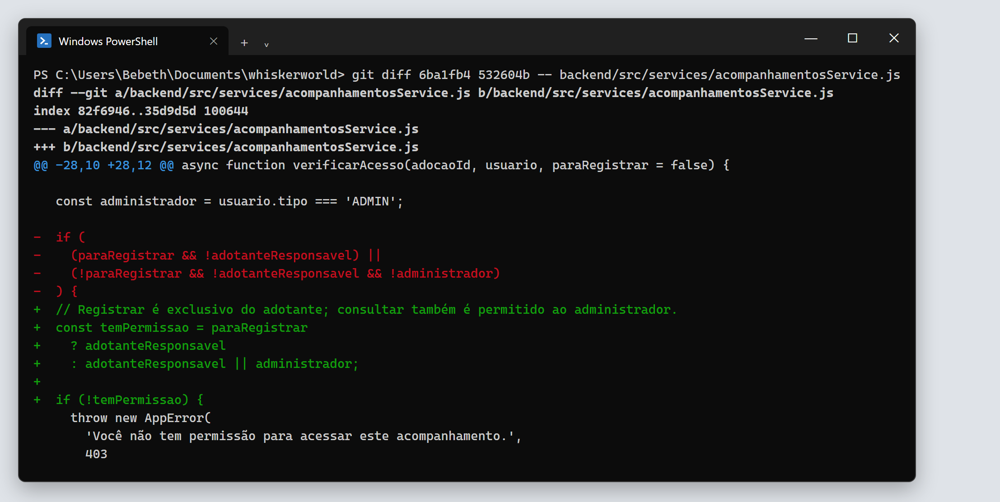
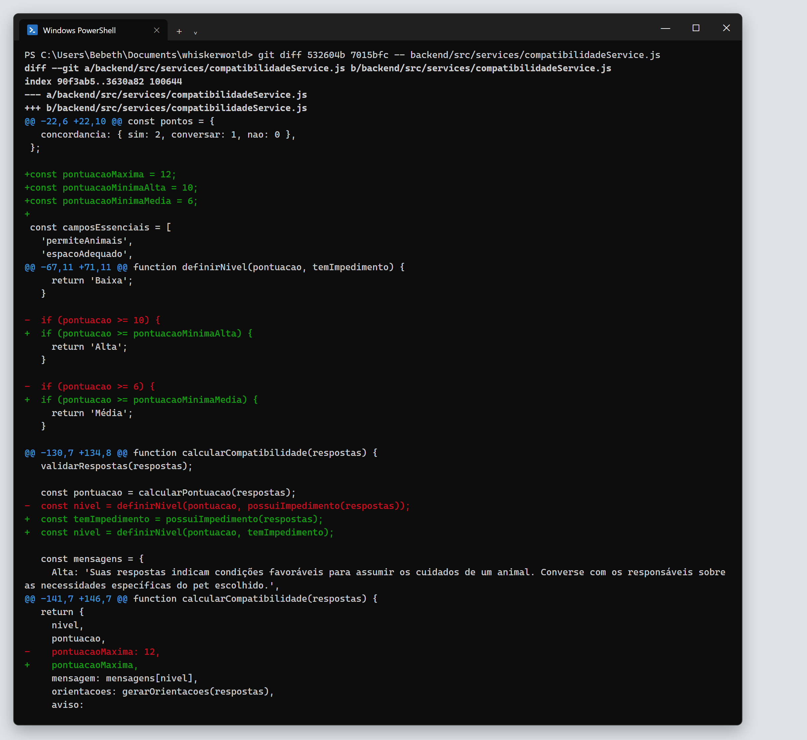
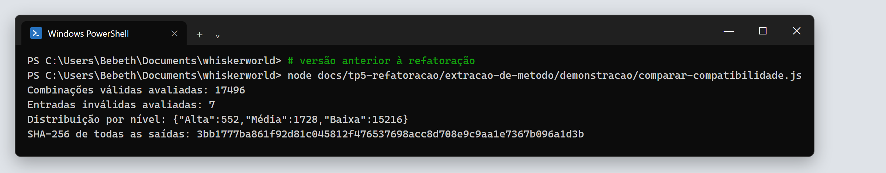
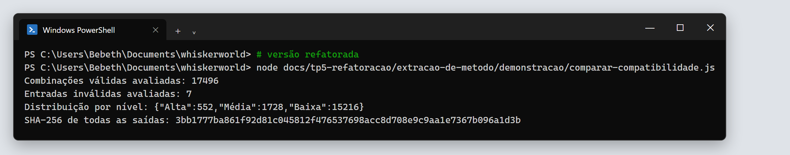
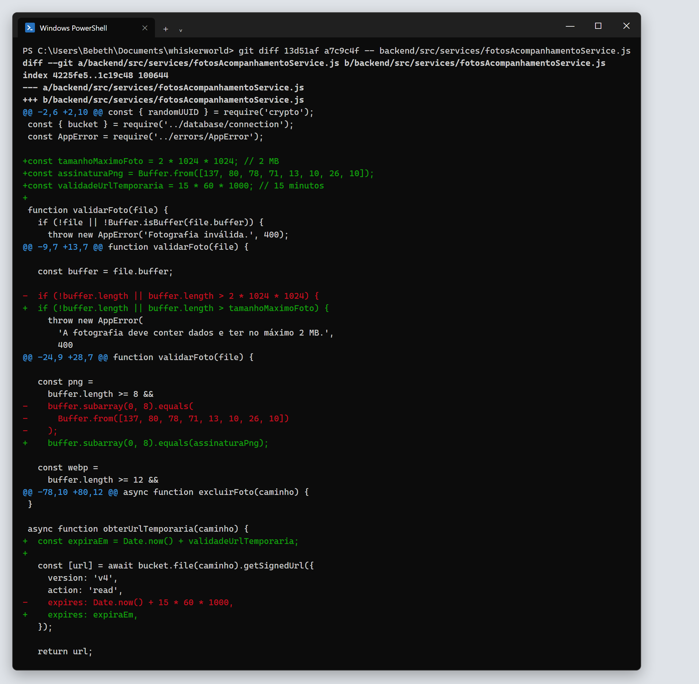
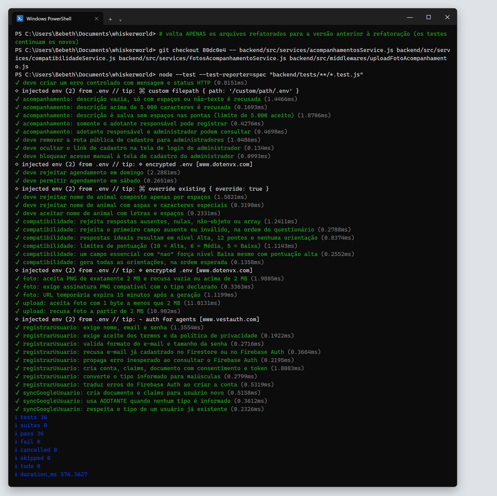
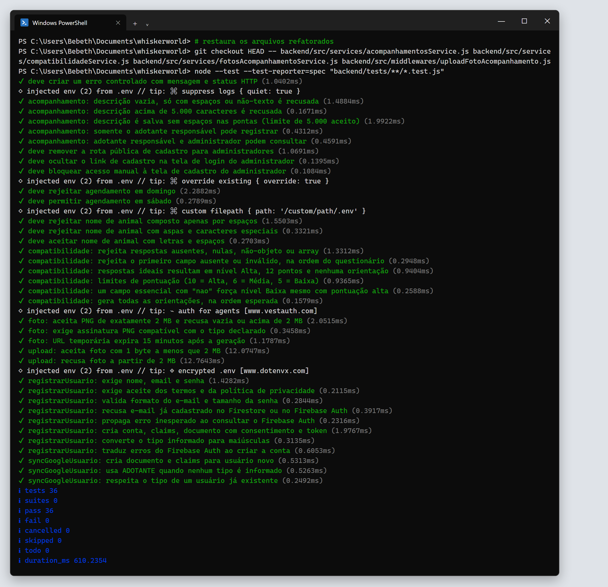

# 2. Refatorações planejadas

Segundo o capítulo 9 de *Engenharia de Software Moderna*, uma refatoração é **planejada** quando é tratada como uma tarefa própria, com tempo reservado, e não como um ajuste feito no meio de outra tarefa.

As três refatorações abaixo foram planejadas assim:

1. **Diagnóstico:** mapeamos `backend/src` e `client/src` e escolhemos as expressões do backend mais difíceis de ler e que envolvem regras de negócio ou de segurança (smells S1 a S3 em [01-code-smells.md](01-code-smells.md)).
2. **Rede de segurança:** conferimos o que os testes existentes cobriam. A regra de permissão (R1) e o serviço de fotos (R3) não tinham nenhum teste, então criamos testes de caracterização antes de mexer no código (commits `6ba1fb4` e `13d51af`). A compatibilidade (R2) já tinha testes dos limites de pontuação e o script de comparação exaustiva da Extração de Método.
3. **Execução em passos pequenos:** uma refatoração por commit, rodando os testes depois de cada uma.
4. **Verificação:** os testes e o hash da compatibilidade precisam ser iguais antes e depois.

---

## R1 — `temPermissao` em `verificarAcesso`

| | |
|---|---|
| **Arquivo** | `backend/src/services/acompanhamentosService.js` |
| **Commit** | `532604b` |
| **Smell resolvido** | S1 – Expressão condicional complexa |
| **Diff completo** | [evidencias/texto/diff-01-tem-permissao.diff](evidencias/texto/diff-01-tem-permissao.diff) |

### Justificativa

O acompanhamento pós-adoção guarda relatos e fotos do animal na casa do adotante. A regra que decide quem pode ver e quem pode registrar esses dados é uma regra de privacidade, e precisa poder ser conferida com facilidade. Na forma original, a condição só dizia quem **não** tinha permissão, misturando as duas operações em uma expressão com cinco negações.

### Antes

```js
const adotanteResponsavel =
  usuario.tipo === 'ADOTANTE' &&
  adocao.usuario_id === usuario.id;

const administrador = usuario.tipo === 'ADMIN';

if (
  (paraRegistrar && !adotanteResponsavel) ||
  (!paraRegistrar && !adotanteResponsavel && !administrador)
) {
  throw new AppError('Você não tem permissão para acessar este acompanhamento.', 403);
}
```

### Depois

```js
const adotanteResponsavel =
  usuario.tipo === 'ADOTANTE' &&
  adocao.usuario_id === usuario.id;

const administrador = usuario.tipo === 'ADMIN';

// Registrar é exclusivo do adotante; consultar também é permitido ao administrador.
const temPermissao = paraRegistrar
  ? adotanteResponsavel
  : adotanteResponsavel || administrador;

if (!temPermissao) {
  throw new AppError('Você não tem permissão para acessar este acompanhamento.', 403);
}
```

### Diff da refatoração

Linhas em vermelho (`-`) foram removidas e linhas em verde (`+`) foram adicionadas.



### O que melhorou

- A condição passou a ser lida como a regra de negócio: "para registrar, precisa ser o adotante responsável; para consultar, o adotante responsável ou o administrador".
- Cada operação ficou em um ramo próprio do ternário. Para mudar quem pode consultar, basta alterar o segundo ramo.
- A condição deixou de ser escrita pela negativa. O `if` agora tem uma única negação: `!temPermissao`.

### Por que o comportamento não mudou

**Equivalência lógica.** Chamando `R = paraRegistrar`, `A = adotanteResponsavel` e `D = administrador`, a condição de recusa era `(R ∧ ¬A) ∨ (¬R ∧ ¬A ∧ ¬D)` e passou a ser `¬(R ? A : A ∨ D)`:

| Operação | Recusa antes | Recusa depois |
|---|---|---|
| Registrar (`R` verdadeiro) | `¬A` | `¬A` |
| Consultar (`R` falso) | `¬A ∧ ¬D` | `¬(A ∨ D)`, que pela lei de De Morgan é `¬A ∧ ¬D` |

**Testes.** Antes da refatoração, nenhum teste cobria essa regra. Criamos dois testes de caracterização (commit `6ba1fb4`) que percorrem a matriz de permissões:

| Usuário | Registrar | Consultar |
|---|---|---|
| Adotante responsável pela adoção | permitido | permitido |
| Outro adotante | 403 | 403 |
| Administrador | 403 | permitido |

Os dois testes passaram no código original e continuaram passando depois da refatoração.

---

## R2 — Pontuação em `compatibilidadeService`

| | |
|---|---|
| **Arquivo** | `backend/src/services/compatibilidadeService.js` |
| **Commit** | `7015bfc` |
| **Smell resolvido** | S2 – Números mágicos |
| **Diff completo** | [evidencias/texto/diff-02-pontuacao-compatibilidade.diff](evidencias/texto/diff-02-pontuacao-compatibilidade.diff) |

### Justificativa

O questionário de compatibilidade (TP4) já tinha sido reorganizado na Extração de Método, mas os limites que definem cada nível continuavam como números soltos dentro de `definirNivel`. São esses valores que vão mudar quando o questionário ganhar perguntas ou pesos novos.

### Antes

```js
function definirNivel(pontuacao, temImpedimento) {
  if (temImpedimento) {
    return 'Baixa';
  }

  if (pontuacao >= 10) {
    return 'Alta';
  }

  if (pontuacao >= 6) {
    return 'Média';
  }

  return 'Baixa';
}

function calcularCompatibilidade(respostas) {
  validarRespostas(respostas);

  const pontuacao = calcularPontuacao(respostas);
  const nivel = definirNivel(pontuacao, possuiImpedimento(respostas));
  ...
  return {
    nivel,
    pontuacao,
    pontuacaoMaxima: 12,
    ...
  };
}
```

### Depois

```js
const pontuacaoMaxima = 12;
const pontuacaoMinimaAlta = 10;
const pontuacaoMinimaMedia = 6;

function definirNivel(pontuacao, temImpedimento) {
  if (temImpedimento) {
    return 'Baixa';
  }

  if (pontuacao >= pontuacaoMinimaAlta) {
    return 'Alta';
  }

  if (pontuacao >= pontuacaoMinimaMedia) {
    return 'Média';
  }

  return 'Baixa';
}

function calcularCompatibilidade(respostas) {
  validarRespostas(respostas);

  const pontuacao = calcularPontuacao(respostas);
  const temImpedimento = possuiImpedimento(respostas);
  const nivel = definirNivel(pontuacao, temImpedimento);
  ...
  return {
    nivel,
    pontuacao,
    pontuacaoMaxima,
    ...
  };
}
```

As constantes ficaram no topo do módulo, junto de `opcoesPermitidas`, `pontos` e `camposEssenciais`, que são as outras regras do questionário. Os nomes seguem o mesmo padrão do arquivo (camelCase).

### Diff da refatoração



### O que melhorou

- Todas as regras do questionário (opções, pesos, campos essenciais e limites) ficaram juntas no topo do arquivo.
- `pontuacao >= pontuacaoMinimaMedia` diz o que significa. `pontuacao >= 6` não dizia.
- `calcularCompatibilidade` passou a mostrar as três informações que definem o resultado (pontuação, impedimento e nível) como passos separados e com nome.

### Decisão: `pontuacaoMaxima` continua fixa

Outra opção seria calcular `pontuacaoMaxima` a partir da tabela `pontos` (6 campos × 2 pontos), para que ela se ajustasse sozinha a uma pergunta nova. Preferimos não fazer isso: seria acrescentar lógica nova, e não apenas dar nome a uma expressão que já existia. Fica registrado como próximo passo.

### Por que o comportamento não mudou

- **Testes:** os testes de caracterização da Extração de Método já cobriam os limites (`10 = Alta, 6 = Média, 5 = Baixa`), o valor `pontuacaoMaxima: 12` e o impedimento. Todos passaram antes e depois.
- **Comparação exaustiva:** reutilizamos o script [comparar-compatibilidade.js](../extracao-de-metodo/demonstracao/comparar-compatibilidade.js), que executa a função para as **17.496 combinações possíveis** de respostas e mais 7 entradas inválidas. O hash SHA-256 das saídas foi o mesmo nas duas versões, e também é o mesmo registrado na Extração de Método: `3bb1777ba861f92d81c045812f476537698acc8d708e9c9aa1e7367b096a1d3b`.





---

## R3 — Limites em `fotosAcompanhamentoService`

| | |
|---|---|
| **Arquivo** | `backend/src/services/fotosAcompanhamentoService.js` |
| **Commit** | `a7c9c4f` |
| **Smell resolvido** | S3 – Números mágicos |
| **Diff completo** | [evidencias/texto/diff-03-fotos-acompanhamento.diff](evidencias/texto/diff-03-fotos-acompanhamento.diff) |

### Justificativa

Este serviço aplica as regras de segurança das fotos enviadas pelo adotante: tamanho máximo, formato verificado pelo conteúdo do arquivo (e não só pela extensão) e validade do link de acesso. Cada uma dessas regras estava escrita como uma conta ou uma sequência de bytes sem explicação.

### Antes

```js
function validarFoto(file) {
  ...
  if (!buffer.length || buffer.length > 2 * 1024 * 1024) {
    throw new AppError('A fotografia deve conter dados e ter no máximo 2 MB.', 400);
  }
  ...
  const png =
    buffer.length >= 8 &&
    buffer.subarray(0, 8).equals(
      Buffer.from([137, 80, 78, 71, 13, 10, 26, 10])
    );
  ...
}

async function obterUrlTemporaria(caminho) {
  const [url] = await bucket.file(caminho).getSignedUrl({
    version: 'v4',
    action: 'read',
    expires: Date.now() + 15 * 60 * 1000,
  });

  return url;
}
```

### Depois

```js
const tamanhoMaximoFoto = 2 * 1024 * 1024; // 2 MB
const assinaturaPng = Buffer.from([137, 80, 78, 71, 13, 10, 26, 10]);
const validadeUrlTemporaria = 15 * 60 * 1000; // 15 minutos

function validarFoto(file) {
  ...
  if (!buffer.length || buffer.length > tamanhoMaximoFoto) {
    throw new AppError('A fotografia deve conter dados e ter no máximo 2 MB.', 400);
  }
  ...
  const png =
    buffer.length >= 8 &&
    buffer.subarray(0, 8).equals(assinaturaPng);
  ...
}

async function obterUrlTemporaria(caminho) {
  const expiraEm = Date.now() + validadeUrlTemporaria;

  const [url] = await bucket.file(caminho).getSignedUrl({
    version: 'v4',
    action: 'read',
    expires: expiraEm,
  });

  return url;
}
```

### Diff da refatoração



### O que melhorou

- As três regras de segurança ficaram no topo do arquivo, com nome. Para mudar o tamanho máximo ou a validade do link, não é preciso procurar dentro das funções.
- `assinaturaPng` explica o que a sequência de bytes representa. Como efeito colateral, o `Buffer` passou a ser criado uma única vez, quando o módulo é carregado, e não a cada foto validada.
- `obterUrlTemporaria` separou o cálculo da expiração (`expiraEm`) da chamada ao Storage.

### Por que o comportamento não mudou

Antes da refatoração, o serviço de fotos não tinha nenhum teste. Criamos três testes de caracterização (commit `13d51af`). Eles substituem o `bucket` do Firebase Storage por um dublê e verificam:

- uma foto PNG de **exatamente 2 MB** é aceita; uma foto vazia ou com 1 byte acima de 2 MB é recusada, com a mesma mensagem;
- um arquivo declarado como PNG, mas sem a assinatura PNG, é recusado, assim como um PNG declarado como JPEG;
- a URL assinada expira **exatamente** 15 minutos depois do momento da geração (o teste fixa `Date.now()` para comparar o valor exato).

Os três testes passaram no código original e continuaram passando depois da refatoração.

---

## Resultado dos testes

O código **anterior** à refatoração foi testado com os testes **novos**: os 36 testes passam. Os mesmos 36 continuam passando depois de todas as refatorações.

| Antes | Depois |
|---|---|
|  |  |
