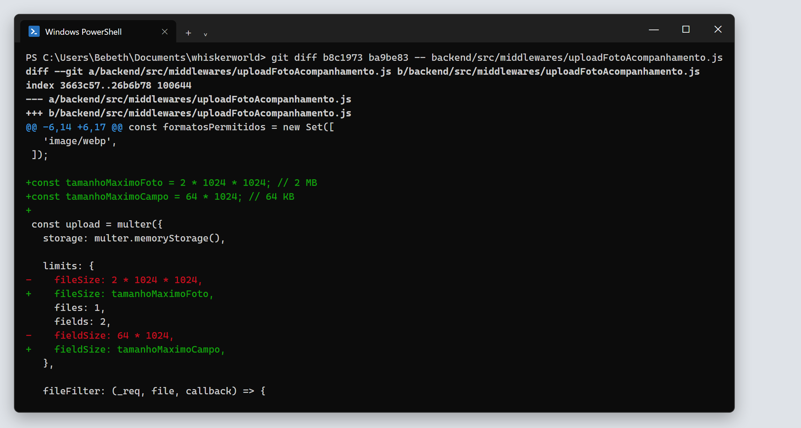

# 3. Refatoração oportunista

Segundo o capítulo 9 de *Engenharia de Software Moderna*, uma refatoração é **oportunista** quando é feita no meio de outra tarefa: ao trabalhar em um trecho de código, o desenvolvedor percebe um problema e o corrige na hora, sem planejamento prévio. É a regra do escoteiro: deixar o código um pouco melhor do que estava.

## R4 — `tamanhoMaximoFoto` no middleware de upload

| | |
|---|---|
| **Arquivo** | `backend/src/middlewares/uploadFotoAcompanhamento.js` |
| **Commit** | `ba9be83` |
| **Smell mitigado** | S4 – Números mágicos duplicados |
| **Diff completo** | [evidencias/texto/diff-04-upload-foto.diff](evidencias/texto/diff-04-upload-foto.diff) |

### Como surgiu

Durante a refatoração planejada R3, ao dar o nome `tamanhoMaximoFoto` ao limite do serviço de fotos, procuramos onde mais o valor `2 * 1024 * 1024` aparecia. No backend, ele também estava no middleware que recebe o upload, na configuração do `multer`, junto de outro número sem nome:

```js
limits: {
  fileSize: 2 * 1024 * 1024,
  files: 1,
  fields: 2,
  fieldSize: 64 * 1024,
},
```

O middleware não fazia parte do plano. Como a regra é a mesma do serviço e já estávamos trabalhando nela, aplicamos a mesma Extração de Variável ali, em um commit separado de R3, para que o histórico mostre o que era planejado e o que foi oportunista.

### Antes

```js
const upload = multer({
  storage: multer.memoryStorage(),

  limits: {
    fileSize: 2 * 1024 * 1024,
    files: 1,
    fields: 2,
    fieldSize: 64 * 1024,
  },
  ...
});
```

### Depois

```js
const tamanhoMaximoFoto = 2 * 1024 * 1024; // 2 MB
const tamanhoMaximoCampo = 64 * 1024; // 64 KB

const upload = multer({
  storage: multer.memoryStorage(),

  limits: {
    fileSize: tamanhoMaximoFoto,
    files: 1,
    fields: 2,
    fieldSize: tamanhoMaximoCampo,
  },
  ...
});
```

### Diff da refatoração



### Justificativa

- O limite da foto passou a ter **o mesmo nome** no serviço e no middleware. Uma busca por `tamanhoMaximoFoto` encontra as duas regras, que precisam mudar juntas.
- `files: 1` e `fields: 2` foram mantidos como estão: são contagens pequenas, e o nome da chave já explica o que significam.

### Por que o comportamento não mudou

O middleware também não tinha testes. Antes de alterá-lo, criamos dois testes de caracterização (commit `b8c1973`). Eles enviam ao middleware uma requisição `multipart/form-data` simulada, sem precisar subir o servidor, e verificam o tamanho a partir do qual a foto é recusada. Os dois passaram antes e depois da refatoração.

### O que os testes revelaram

Ao escrever esses testes, esperávamos que o middleware aceitasse uma foto de exatamente 2 MB, como o serviço aceita. Não é o que acontece:

| Tamanho da foto | Middleware (`multer`) | Serviço (`validarFoto`) |
|---|---|---|
| 2 MB − 1 byte | aceita | aceita |
| **exatamente 2 MB** | **recusa** | aceita |
| 2 MB + 1 byte | recusa | recusa |

O `multer` considera o limite atingido quando o arquivo **chega** a `fileSize` bytes, enquanto o serviço só recusa quando o arquivo **passa** de 2 MB. Na prática, a foto de exatamente 2 MB é barrada pelo middleware e nunca chega ao serviço.

**Não corrigimos essa diferença nesta entrega.** Uma refatoração não pode alterar o comportamento do sistema, e o teste de caracterização registra o comportamento atual, com um comentário explicando o motivo. A correção (por exemplo, usar `tamanhoMaximoFoto + 1` no `multer`, ou `>=` no serviço) muda o que o sistema aceita e deve ser feita em uma tarefa separada.

Esse achado é um exemplo de por que vale escrever testes de caracterização antes de refatorar: ao descrever o que o código faz hoje, eles também mostram o que ele faz de diferente do que se imaginava.

### Planejada x oportunista: comparação

| | R1, R2 e R3 (planejadas) | R4 (oportunista) |
|---|---|---|
| Origem | Mapeamento prévio do código | Percebida durante R3 |
| Preparação | Testes de caracterização escritos antes, quando faltavam | Testes escritos na hora, antes de alterar o middleware |
| Tamanho | Uma regra de negócio ou de segurança por refatoração | Duas expressões em um único bloco de configuração |
| Commit | Próprio, previsto no plano | Próprio, criado na hora |
