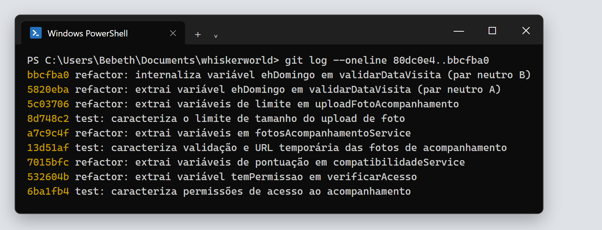

# Refatoração: Extração de Variável (*Extract Variable*)

Parte da **TP5 – Refatoração** do Whiskerworld. Este diretório reúne tudo o que foi feito com a refatoração **Extração de Variável**, do catálogo de Martin Fowler, tomando como referência o [capítulo 9 de *Engenharia de Software Moderna*](https://engsoftmoderna.info/cap9.html).

> **Extração de Variável:** pegar uma expressão difícil de entender, guardar o seu resultado em uma variável com um nome que explique o que ela representa e usar essa variável no lugar da expressão.

## Por que escolhemos a Extração de Variável

- **Ela resolve os problemas que encontramos.** O mapeamento de `backend/src` e `client/src` encontrou condições compostas difíceis de ler, números sem nome em regras de negócio e de segurança, e o mesmo limite escrito em vários arquivos ([01-code-smells.md](01-code-smells.md)). A Extração de Variável é a forma mais direta de dar nome a cada uma dessas expressões.
- **Ela é segura para o restante do sistema.** As variáveis extraídas ficam internas a cada arquivo: nenhum `module.exports` mudou. Por isso, controllers, rotas e frontend não precisaram de nenhuma alteração.
- **Ela complementa a Extração de Método.** A Extração de Método reorganizou os métodos longos em etapas com nome. A Extração de Variável atua dentro dessas etapas, dando nome às expressões e aos valores que ainda estavam sem explicação.

## Navegação

| # | Documento | O que contém |
|---|---|---|
| 1 | [01-code-smells.md](01-code-smells.md) | *Code smells* encontrados no projeto e por que cada um é um problema |
| 2 | [02-refatoracoes-planejadas.md](02-refatoracoes-planejadas.md) | Refatorações **planejadas**: justificativa e código antes/depois |
| 3 | [03-refatoracao-oportunista.md](03-refatoracao-oportunista.md) | Refatoração **oportunista**, feita durante outra refatoração, e o que os testes revelaram |
| 4 | [04-par-neutro-extract-inline.md](04-par-neutro-extract-inline.md) | Par **A + B** (Extract Variable + Inline Variable) que se anulam |
| — | [demonstracao/gerar-prints/](demonstracao/gerar-prints/) | Script que gera os prints a partir da saída real dos comandos |
| — | [evidencias/prints/](evidencias/prints/) | Prints do terminal (testes, hashes, diffs e par neutro) |
| — | [evidencias/texto/](evidencias/texto/) | As mesmas evidências em texto: diffs, resultados dos testes e hashes |

## Resumo

| # | Refatoração | Tipo | Arquivo | Commit |
|---|---|---|---|---|
| R1 | Condição de acesso vira `temPermissao` | Planejada | `backend/src/services/acompanhamentosService.js` | `532604b` |
| R2 | Limites de pontuação e `temImpedimento` ganham nome | Planejada | `backend/src/services/compatibilidadeService.js` | `7015bfc` |
| R3 | Limite, assinatura PNG e validade da URL ganham nome | Planejada | `backend/src/services/fotosAcompanhamentoService.js` | `a7c9c4f` |
| R4 | `tamanhoMaximoFoto` no middleware de upload | Oportunista | `backend/src/middlewares/uploadFotoAcompanhamento.js` | `5c03706` |
| A | `ehDomingo` extraída (Extract Variable) | Par neutro | `backend/src/services/agendamentosService.js` | `5820eba` |
| B | `ehDomingo` internalizada (Inline Variable) | Par neutro | `backend/src/services/agendamentosService.js` | `bbcfba0` |

## Como garantimos que o comportamento não mudou

Três dos quatro arquivos refatorados não tinham nenhum teste cobrindo os trechos alterados. Antes de alterar o código, criamos **testes de caracterização** para eles. Esses testes registram como o sistema se comporta hoje e só aceitamos a refatoração quando todos continuaram passando.

| Commit | Testes criados | O que cobrem |
|---|---|---|
| `6ba1fb4` | 2 | Quem pode registrar e quem pode consultar o acompanhamento (R1) |
| `13d51af` | 3 | Limite de 2 MB, assinatura PNG e validade de 15 minutos da URL da foto (R3) |
| `8d748c2` | 2 | Tamanho a partir do qual o middleware recusa a foto (R4) |

| Verificação | Antes da refatoração | Depois da refatoração |
|---|---|---|
| Testes automatizados (`npm test`) | 36 de 36 passando | 36 de 36 passando |
| Hash SHA-256 das saídas de `calcularCompatibilidade` nas 17.496 combinações de respostas | `3bb1777b…6a1d3b` | `3bb1777b…6a1d3b` |
| Conteúdo de `agendamentosService.js` antes de A e depois de B | blob `4f60b9ca…` | blob `4f60b9ca…` |

Na linha "antes", o código anterior à refatoração foi testado com os testes novos. Os 7 testes criados também passam no código original, o que mostra que eles descrevem o comportamento que já existia.

| Testes – antes | Testes – depois |
|---|---|
|  |  |

| Comparação exaustiva – antes | Comparação exaustiva – depois |
|---|---|
|  |  |

### Sobre as evidências

- **Prints** ([evidencias/prints/](evidencias/prints/)): as imagens foram **geradas automaticamente a partir da saída real dos comandos**, executados no Windows PowerShell deste repositório. O script [gerar-prints/gerar.sh](demonstracao/gerar-prints/gerar.sh) roda cada comando, captura a saída com as cores e a renderiza com a aparência do Windows Terminal. Ele reaproveita o renderizador e o script de comparação da [Extração de Método](../extracao-de-metodo/). Para reproduzir as imagens, basta rodar o script de novo.
- **Arquivos de texto** ([evidencias/texto/](evidencias/texto/)): a mesma saída em texto puro (`testes-*.txt`, `hash-*.txt`, `prova-par-neutro.txt`). Os arquivos `.diff` mostram exatamente o que mudou em cada refatoração: linhas com `-` foram removidas e linhas com `+` foram adicionadas.

## Histórico de commits

Cada etapa ficou em um commit separado na branch `refactor/extracao-de-variavel`, para que antes e depois possam ser comparados com `git diff`:



```text
6ba1fb4 test: caracteriza permissões de acesso ao acompanhamento
532604b refactor: extrai variável temPermissao em verificarAcesso                (R1 - planejada)
7015bfc refactor: extrai variáveis de pontuação em compatibilidadeService         (R2 - planejada)
13d51af test: caracteriza validação e URL temporária das fotos de acompanhamento
a7c9c4f refactor: extrai variáveis em fotosAcompanhamentoService                  (R3 - planejada)
8d748c2 test: caracteriza o limite de tamanho do upload de foto
5c03706 refactor: extrai variáveis de limite em uploadFotoAcompanhamento          (R4 - oportunista)
5820eba refactor: extrai variável ehDomingo em validarDataVisita (par neutro A)
bbcfba0 refactor: internaliza variável ehDomingo em validarDataVisita (par neutro B)
```
