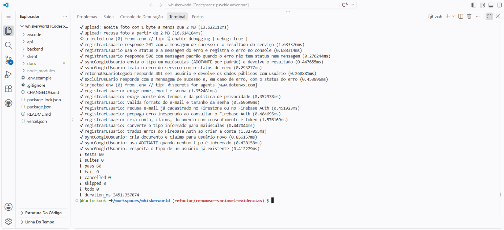
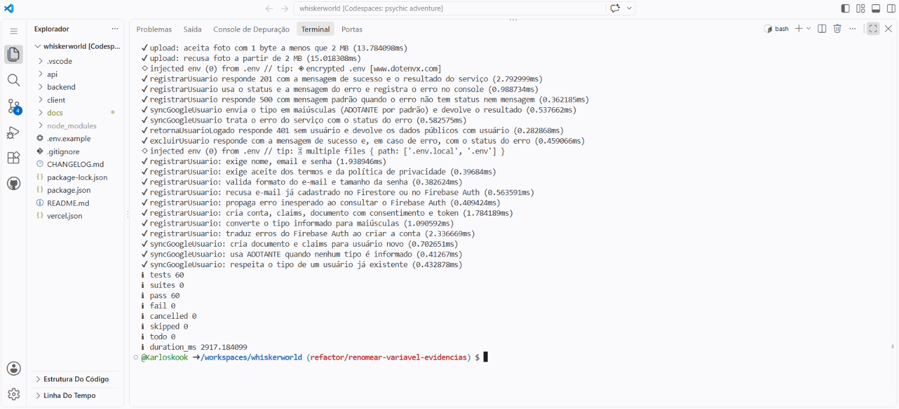

# Refatoração: Renomear Variável (*Rename Variable*)

Parte do **TP5 – Refatoração** do Whiskerworld. Este diretório reúne tudo o que foi feito com a refatoração **Renomear Variável**, do catálogo de Martin Fowler, tomando como referência o [capítulo 9 de *Engenharia de Software Moderna*](https://engsoftmoderna.info/cap9.html).

> **Renomear Variável:** trocar o nome de uma variável ou parâmetro por outro que explique melhor o que ela guarda, atualizando todas as referências. O comportamento do sistema não muda.

## Por que escolhemos Renomear Variável

- **Resolve o smell "Nome Misterioso".** O projeto tem nomes como `count`, `body` e `err`, que não dizem o que o valor representa ([01-code-smells.md](01-code-smells.md)).
- **É a mais segura das refatorações.** Só mudam identificadores locais. Nenhum `module.exports`, rota ou resposta da API foi alterado, então o frontend e os demais módulos não precisaram de ajuste.
- **Complementa as outras técnicas da equipe.** A Extração de Método e a Extração de Variável criaram funções e variáveis novas; Renomear Variável melhora os nomes das que já existiam.

## Navegação

| # | Documento | O que contém |
|---|---|---|
| 1 | [01-code-smells.md](01-code-smells.md) | *Code smells* encontrados, por que são problema e quais foram tratados ou não |
| 2 | [02-refatoracoes-planejadas.md](02-refatoracoes-planejadas.md) | Refatorações **planejadas** (R1 a R5): justificativa e código antes/depois |
| 3 | [03-refatoracao-oportunista.md](03-refatoracao-oportunista.md) | Refatorações **oportunistas** (O1 e O2), feitas durante a escrita dos testes |
| 4 | [04-par-neutro-extract-inline.md](04-par-neutro-extract-inline.md) | Par **A + B** que se anulam, com prova |
| — | [evidencias/texto/](evidencias/texto/README.md) | Diffs, resultados dos testes e prova do par neutro, em texto |
| — | [evidencias/prints/](evidencias/prints/) | Prints do terminal com os testes antes e depois |
| — | [demonstracao/gerar-evidencias.sh](demonstracao/gerar-evidencias.sh) | Script que gera as evidências a partir da saída real dos comandos |

## Resumo

| # | Refatoração | Tipo | Arquivo | Commit |
|---|---|---|---|---|
| R1 | `count` → `quantidadeRemovida` | Planejada | `backend/src/services/favoritosService.js` | `93bbe26` |
| R2 | `body` → `dadosNovoAnimal` | Planejada | `backend/src/services/animaisService.js` | `b888838` |
| R3 | `body` → `dadosAtualizacao` | Planejada | `backend/src/services/animaisService.js` | `b888838` |
| R4 | `err` → `erro` | Planejada | `backend/src/controllers/usuariosController.js` | `b888838` |
| R5 | `count` → `quantidadeRemovida` | Planejada | `backend/src/services/animaisService.js` | `b888838` |
| O1 | `result` → `resultado` | Oportunista | `backend/src/controllers/usuariosController.js` | `488d276` |
| O2 | `atual` → `animalAtual` | Oportunista | `backend/src/services/animaisService.js` | `488d276` |
| A | `quantidadeRemovida` → `totalRemovido` | Par neutro | `backend/src/services/favoritosService.js` | `11c6d59` |
| B | `totalRemovido` → `quantidadeRemovida` | Par neutro | `backend/src/services/favoritosService.js` | `f2c0e9f` |

R1 a R5 e O1/O2 são casos da **mesma técnica** (Renomear Variável) aplicados em lugares diferentes; não são técnicas distintas.

## Evidência de "antes e depois"

### R1 — `favoritosService.js`

```diff
-  const count = await favoritosRepository.remove(usuarioId, animalId);
-  if (!count) {
+  const quantidadeRemovida = await favoritosRepository.remove(usuarioId, animalId);
+  if (!quantidadeRemovida) {
     throw new AppError('Favorito não encontrado.', 404);
   }
```

### R2 e R3 — `animaisService.js`

```diff
-async function criarAnimal(body, arquivo) {
-  const { nome, sexo, tipo, idade, porte, descricao } = body;
+async function criarAnimal(dadosNovoAnimal, arquivo) {
+  const { nome, sexo, tipo, idade, porte, descricao } = dadosNovoAnimal;
```

```diff
-async function atualizarAnimal(id, body, arquivo, adminId) {
+async function atualizarAnimal(id, dadosAtualizacao, arquivo, adminId) {
```

### R4 — `usuariosController.js`

```diff
-function handleError(res, err) {
-  console.error(err);
+function handleError(res, erro) {
+  console.error(erro);
```

### R5 — `animaisService.js`

```diff
-  const count = await animaisRepository.remove(id);
-  if (!count) {
+  const quantidadeRemovida = await animaisRepository.remove(id);
+  if (!quantidadeRemovida) {
```

Os diffs completos estão em [evidencias/texto/](evidencias/texto/README.md). O antes/depois comentado de cada refatoração está em [02-refatoracoes-planejadas.md](02-refatoracoes-planejadas.md).

## Como garantimos que o comportamento não mudou

Renomear uma variável não deveria mudar nada, mas isso precisa ser **verificado**. Os arquivos `favoritosService.js`, `animaisService.js` (criar, atualizar e remover) e `usuariosController.js` não tinham testes para os trechos alterados. Por isso criamos **testes de caracterização**: testes que registram como o código se comporta e que devem passar igualmente no código original e no refatorado.

| Arquivo de teste | Testes | O que cobre |
|---|---|---|
| `backend/tests/favoritosService.test.js` | 4 | `removerFavorito`: remove, 404 quando nada foi removido, 401 sem usuário, 400 sem `animal_id` |
| `backend/tests/animaisServiceCaracterizacao.test.js` | 13 | `criarAnimal`, `atualizarAnimal` e `deletarAnimal`: dados repassados ao repositório, maiúsculas, `vacinado`, valores mantidos na atualização, 400, 403 e 404 |
| `backend/tests/usuariosController.test.js` | 7 | `handleError` e blocos `catch`: status e mensagem do erro, 500 padrão, 201, 401 |

Esses testes foram executados em duas versões do código, com a mesma suíte:

| Versão | Como obter | Resultado |
|---|---|---|
| **Antes** | arquivos de `favoritosService`, `animaisService` e `usuariosController` como estavam antes de R1–R5 (`93bbe26^` e `b888838^`) | ver [testes-antes.txt](evidencias/texto/testes-antes.txt) |
| **Depois** | código refatorado (esta branch) | ver [testes-depois.txt](evidencias/texto/testes-depois.txt) |

Para gerar esses arquivos (e os diffs) com a saída real dos comandos, basta rodar, na raiz do repositório:

```bash
bash docs/tp5-refatoracao/renomear-variavel/demonstracao/gerar-evidencias.sh
```

| Testes – antes | Testes – depois |
|---|---|
|  |  |

## Histórico de commits

Cada etapa ficou em um commit separado, para que antes e depois possam ser comparados com `git diff`:

```text
93bbe26 refactor: renomeia variavel count para quantidadeRemovida no favoritosService   (R1)
b888838 refactor: renomeia variaveis genericas em animaisService e usuariosController   (R2 a R5)
a5f2b96 test: caracteriza favoritosService, animaisService e usuariosController antes de renomear variáveis
488d276 refactor: renomeia result para resultado e atual para animalAtual               (O1 e O2, oportunista)
11c6d59 refactor: renomeia quantidadeRemovida para totalRemovido                        (par neutro A)
f2c0e9f refactor: renomeia totalRemovido de volta para quantidadeRemovida               (par neutro B)
```

> Os hashes valem enquanto o PR for integrado com **merge commit** (não use "Squash and merge"), porque o squash cria um commit novo e os commits acima deixam de existir na `main`.

## Limites desta entrega

- **S7** (`val` no frontend) e **S8** (`err` nos demais controllers) foram identificados e **não foram tratados** ([01-code-smells.md](01-code-smells.md)).
- O frontend não tem testes automatizados; por isso a entrega se concentrou no backend.
